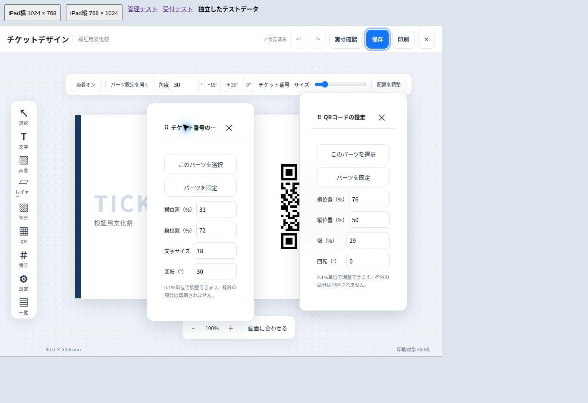

# 受付・管理アプリ 再デバッグ（2026-10-30）

## 前回と異なる確認方法

基準は main `cd3a98c1d05920d71f35ad7b82d4b648c1a5f260`（PR #48まで）。最初に既存のクライアント75件とFirestoreルール・実SDK統合52件が通ることを確認した。そのうえで、通常操作の繰り返しだけでなく、応答の順番を変える、2画面で同時に保存する、保存中に承認を取り消す、削除後に古い画面から操作する、といった条件を追加した。

新しい再現テストで修正前の失敗を確認し、修正後に回帰テスト全体を再実行した。受付・管理の画面は、独立した検証用データを使ってChromeでも操作した。本番のイベント、受付記録、端末承認は検証用に変更していない。

## 見つけて修正した問題

| 対象 | 再現条件と不具合 | 修正 |
| --- | --- | --- |
| 受付の端末内データ | 2画面が同時にイベントを更新すると、保存後の別トランザクションでの検証が他画面の更新を破損と判定し、正常な保存まで消す | 保存と件数・IDの検証を同一トランザクションに統合。検証失敗時は書き込み全体を中止し、直前の正常なデータを保持 |
| 受付データの版数 | 新しい版を保存した後に古い通信応答が届くと、同じイベントの設定・有効状態を古い版へ戻せる | 保存トランザクション内で現在の版数を確認し、古い版を拒否 |
| 受付の再起動時検証 | イベントの読み取りと枚数確認の間に別画面が更新できる | 同一の読み取りトランザクションで確認。曖昧な不一致から端末内データを消去しない |
| 承認取消と遅い通信 | イベント認証のダウンロード中に承認を取り消しても、遅れた成功応答がイベントを保存して認証準備を戻す | 承認状態の世代を確認し、失効した処理の結果を適用しない。手動受信、QR認証、コード認証、自動取得に適用 |
| 受付中の遠隔操作 | 1件の受付を処理している間に入口・出口の指示が届くと、画面と処理中の判定モードが食い違う | 入口・出口の変更は処理完了後、次のスキャン前に適用。停止指示は即時停止を維持 |
| 再公開と別の管理画面 | 別の管理画面が開催中・終了処理中へ進めても、古い画面から再公開すると受付可能へ戻せる | 再公開時の状態はトランザクションで読んだ保存済み状態を使用 |
| 終了済みイベント | 古い状態更新が終了済みイベントを再開できる | 状態更新もトランザクション化し、終了済みからの再開を拒否 |
| 削除済みイベント | 古い画面から再公開すると、削除した親イベントを作り直せる | 公開時にイベントの存在を確認し、存在しなければ拒否 |
| 公開直後の自動状態更新 | 公開結果を画面へ設定すると受付対象フラグが欠落し、自動開始・終了確認が再読み込みまで停止する | 画面上の公開済みイベントにも受付対象フラグを保持 |
| 公開用QRの表示 | 初回の公開情報読み込みが遅れ、公開成功後に古い「未公開」の結果が到着すると認証QRが消える | 読み込みの世代を管理し、公開処理より古い結果を無視 |
| イベント削除中の操作 | 削除完了時に操作開始時の履歴を戻し、途中で追加されたイベントを画面から落としたり、別に選んだイベントを切り替えたりする | 最新の履歴から対象だけを除去し、別イベントの選択を維持 |
| チケット追加発行 | 最大の発行番号を持つチケットを削除すると、一覧から計算した開始番号が発行済み番号と競合し、以後の発行が止まる | サーバーの発行済み番号、現存番号、内部IDを確認して次の番号を計算。終了済みへの新規発行も拒否 |
| 背景画像と取り消し | 解析中に元に戻しても、遅れて返る解析結果が取り消した背景を復活させる | 取り消し・やり直し・リセット・画面終了で古い読み込みを無効化。解析待ちの間に調整したQR位置とロックも保持 |
| バックアップ入力 | 存在しない復元先、部員ID・番号の重複、実在しない日付、不正な時刻・版数を通せる | Firebaseへの書き込み前に形式と参照先を検証して拒否 |
| 自分の端末表示 | 承認済みでも「登録前」「この端末」が固定表示され、実際の登録状態・IDを確認できない | 確認済みの承認状態、端末種別、実際の端末IDを表示 |

## 実行結果

| 検証 | 結果 |
| --- | --- |
| `npm run test:client` | 87件成功 |
| `npm run test:rules` | 55件成功。Firestoreエミュレータと実SDKを使用 |
| `npm run test:callables` | 11件成功。保持しているFunctionsソースのエミュレータ検証のみ |
| `npm run typecheck` | 成功 |
| `npm run build` | 管理・受付とも成功 |
| `npm run typecheck --prefix functions` | 通常・移行用の型検査とも成功 |
| `git diff --check` | 成功 |

自動テストは合計153件。拒否を確認するテストのPERMISSION_DENIEDは期待された結果。ビルドには既存の大きいバンドル・静的/動的import混在の警告が残るが、コンパイルエラーではない。

## ブラウザーで確認した内容

本体のReactコンポーネント・CSS・IndexedDBを使用し、Firebaseの通信先・承認結果・カメラ入力・音声だけを検証用アダプターに置き換えた。HTTPのローカルプレビューには `crypto.randomUUID` の互換実装を用意した。本番はHTTPSで標準APIを使用する。これを本番の不具合として数えていない。

- 1024×768と768×1024の表示領域でデザイン画面を開き、縦画面では画面幅768px・内容幅768pxであることを確認。
- QRと番号の設定を同時に開く、片方だけを移動する、角度を編集する、保存・閉じる操作を確認。
- 500枚のチケット一覧から末尾の `TKT000500` を検索してQRを表示。
- デザイン画面で、500枚の印刷用カードすべてに実際のQR SVGが生成されることを確認。
- 会場内人数のグラフに30記録の折れ線・実際の線色があり、時刻スライダーの操作で09:29の10人から09:00の1人へ選択が変わることを確認。
- 端末管理で承認済みの状態と実際の端末IDを確認。
- 受付で同じチケットの入場→退場→再入場を行い、未送信3件を保持。停止・ページ再読み込み後も3件を復元し、同じチケットの重複入場を拒否することを確認。

このブラウザー確認はChromeと検証用通信先によるもの。iPad/Safari実機のカメラ、録音音声の実際の出力、電池持ち、スリープ復帰、AirPrintの実紙出力は保証しない。



## Firebaseルールの再監査

権限の根拠、create/update差分、所有者とインストールの対応、受付記録を伴う原子的な状態変更、型・サイズ制約を再確認した。今回ルールの変更はない。未承認・受付専用端末からの権限昇格は、既存の拒否テストを含めて通過しない。

```json
{
  "score": 4,
  "summary": "今回の検証範囲で新たな権限昇格経路は確認されなかった。クライアントの状態競合を修正し、既存の所有関係・承認境界を維持した。",
  "findings": [
    {
      "check": "Type Safety / Business Logic vs Rules",
      "severity": "minor",
      "issue": "承認済み管理者のイベント・チケットCRUDは広い権限を持つ。管理者自身がUI以外から行う任意変更まで全スキーマで厳格に制約する構成ではない。",
      "recommendation": "管理者を信頼する現行モデルを維持する。より細かい制約を追加する場合は、バックアップ復元・既存データとの互換性を別途検証する。"
    }
  ]
}
```

## 引き続き残る制約

完全に通信しない別々の入口・出口端末の間では状態を共有できない。別端末での重複利用や、入口端末だけが持つ入場記録の出口照合を今回の修正で解決したとは扱わない。未送信記録を捏造して解決する処理も追加していない。

Spark構成、既存のFirestoreルール、課金設定は維持。Functionsの本番配置、有料APIの有効化、本番データの初期化は行わない。この検証結果は「バグが一切ない」という保証ではなく、記載した再現条件と範囲での確認結果である。
